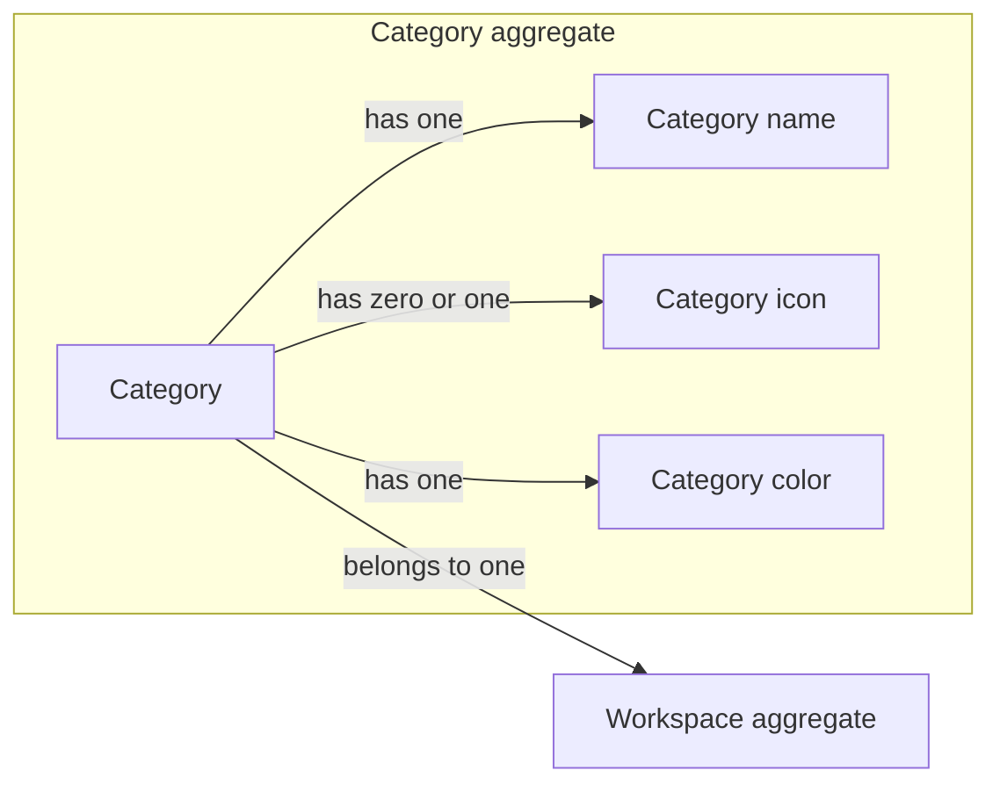

# Categories

The Categories domain models the Categories a Workspace uses to classify its
content. A Category gives a classification a name, an optional icon, and a
color so that people can recognize it at a glance.

Categories currently stand on their own within a
[Workspace](workspaces.md#workspace-aggregate). They are not yet part of a
[Budget](budget.md), have no kind, and are not ordered; how they will relate
to Budgets and Operations is unresolved.

## Model structure

| Concept | Classification | Boundary and relationships |
| --- | --- | --- |
| Category | Entity and aggregate root | Owns its name, icon, and color; references one Workspace by identity. |
| Category identity | Value object | Identifies a Category independently of its other fields. |
| Category name | Value object | Names a Category in plain, untranslated text. |
| Category icon | Value object | Names one icon from the icon catalog. |
| Category color | Value object | Names one color from the color palette. |

## Category aggregate

A Category is a named classification belonging to one Workspace. Its identity
remains the same when its name, icon, or color changes.

| Field | Domain value | Required | Meaning and rules |
| --- | --- | --- | --- |
| Identity | Category identity | Yes | Distinguishes this Category from all other Categories; nonempty, assigned on creation, and stable. |
| Workspace | [Workspace identity](workspaces.md#value-objects) | Yes | References the existing Workspace the Category belongs to; set on creation and never changes. The Workspace is not part of the Category aggregate. |
| Name | Category name | Yes | Names the Category; need not be unique, including within its Workspace. |
| Icon | Category icon | No | Pictures the Category; absence means the Category has no icon. |
| Color | Category color | Yes | Marks the Category with one color from the palette. |

Renaming a Category, or changing its icon or color, changes only that field.
A Category cannot be moved to another Workspace.

## Value objects

| Value object | Field | Meaning and rules |
| --- | --- | --- |
| Category identity | Identity value | Nonempty identity of one Category. |
| Category name | Name text | Plain text that is not translated. Valid text with at least one non-whitespace character and at most 100 characters. |
| Category icon | Icon name | One name from the icon catalog, drawn from the Tabler icon set; a name outside the catalog is not an icon. |
| Category color | Color name | One of `green`, `blue`, `orange`, `red`, `purple`, `brown`, `grey`, or `yellow`. |

## Invariants across aggregates

- Every Category belongs to exactly one existing Workspace.
- A Workspace may have any number of Categories, including none.
- Deleting a Workspace deletes all of its Categories.
