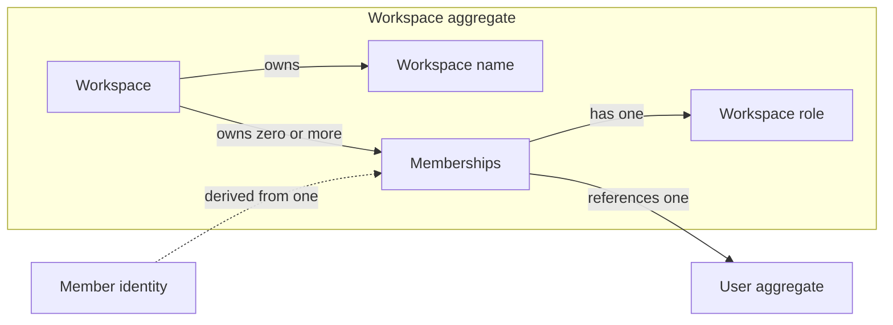

# Workspaces

The Workspaces domain models workspaces and the Users who are their members.
A Workspace groups [Users](users.md#user) under a shared name. Each member
has a Workspace role, which decides what they may do in that Workspace.

Workspace roles are separate from the system-wide
[Roles and Permissions](users.md), which govern the admin panel rather than
what a member does inside a Workspace.

## Model structure

| Concept | Classification | Boundary and relationships |
| --- | --- | --- |
| Workspace | Entity and aggregate root | Owns a name and its memberships; references Users only by identity. |
| Membership | Value object | Records that one User belongs to one Workspace with a Workspace role; owned by that Workspace. |
| Workspace role | Value object | Names what a member may do in the Workspace. |
| Workspace identity | Value object | Identifies a Workspace independently of its name and members. |
| Workspace name | Value object | Names a Workspace in plain, untranslated text. |
| Member identity | Derived value | Derived from one Membership; describes who acts in one Workspace and with what Workspace role. |

## Workspace aggregate

A Workspace is a named group of Users. Its identity remains the same when its
name or members change. The Workspace aggregate contains its memberships; the
Users they reference have their own lifecycle and are outside the aggregate.

| Field | Domain value | Required | Meaning and rules |
| --- | --- | --- | --- |
| Identity | Workspace identity | Yes | Distinguishes this Workspace from all other Workspaces; nonempty, assigned on creation, and stable. |
| Name | Workspace name | Yes | Names the Workspace; need not be unique among Workspaces. |
| Members | Collection of memberships | Yes; may be empty | Lists the Users who belong to the Workspace, at most once each; unordered. |

Renaming a Workspace changes only its name. Adding or removing a member, or
changing a member's role, changes only its memberships.

Every Workspace is created by a User, who becomes its owner in the same
change.

Deleting a Workspace removes all of its memberships; the Users who were its
members remain.

### Membership

A Membership records that a User belongs to a Workspace. It has no identity of
its own: the Workspace and User it relates determine it, and two Memberships
relating the same Workspace and User are the same Membership.

| Field | Domain value | Required | Meaning and rules |
| --- | --- | --- | --- |
| Workspace | Workspace identity | Yes | Identifies the Workspace that owns the Membership. |
| User | [User identity](users.md#account-and-authority-values) | Yes | References one existing User by identity; the User is not part of the Workspace aggregate. |
| Role | Workspace role | Yes | Decides what the User may do in the Workspace. A member added without a role is a viewer. |

### Workspace role

A Workspace role is one of three values, from the least to the most
authority:

| Value | Meaning |
| --- | --- |
| `viewer` | Views the Workspace's content. |
| `editor` | Views and edits the Workspace's content. |
| `owner` | Also renames the Workspace and manages its members. |

Each role allows these actions:

| Action | viewer | editor | owner |
| --- | --- | --- | --- |
| View workspace content | yes | yes | yes |
| Edit workspace content | no | yes | yes |
| Rename the workspace | no | no | yes |
| Add, remove, or change the role of members | no | no | yes |

An action a member's role does not allow is denied. An owner never changes
their own role, even beside another owner; only another owner can change it. A User who is not a
member cannot tell the Workspace from a missing one.

## Derived values

### Member identity

A member identity describes who acts in one Workspace and with what authority
there. It is derived from the acting User's
[authenticated identity](security.md#authenticated-identity) and that User's
Membership in the Workspace when the User enters the Workspace, and it
accompanies every action they then perform there. It has no identity or
lifecycle of its own.

| Field | Domain value | Meaning and rules |
| --- | --- | --- |
| Workspace | Workspace identity | The only Workspace in which the identity permits anything. |
| User | [User](users.md#user) | The member who acts. |
| Role | Workspace role | The member's role at the moment of derivation. |

A User who is not a member has no member identity for the Workspace, so they
cannot tell it from a missing one. A member identity for one Workspace permits
nothing in another, and such an action is treated as one by a User who is not
a member. An action performed for no member identity is not authenticated.

The role a member identity carries can become outdated while the member acts.
A change to the Workspace or its content therefore checks the member's current
role again at the moment it applies: a change that relies on a role and a
change to that role apply one after the other, never interleaved, and a member
who has left or whose role no longer allows the change is refused.

## Value objects

| Value object | Field | Meaning and rules |
| --- | --- | --- |
| Workspace identity | Identity value | Nonempty identity of one Workspace. |
| Workspace role | Role value | One of `viewer`, `editor`, or `owner`; see [Workspace role](#workspace-role) for what each allows. |
| Workspace name | Name text | Plain text that is not translated. Leading and trailing whitespace is removed from a supplied name; the result is valid text with a non-whitespace character, has no leading or trailing whitespace, and is at most 100 characters. |

## Aggregate invariants

- A Workspace has at most one Membership for any User.
- A Workspace may have no members.
- A Workspace that has an owner always keeps at least one: removing or
  demoting its last owner fails.
- Every Membership belongs to exactly one Workspace and ends when that
  Workspace is deleted.

## Invariants across aggregates

- Every Membership references an existing User.
- A User may be a member of any number of Workspaces, including none.
- Deleting a Workspace deletes its [Categories](categories.md).
- Deleting a User removes that User's Memberships from every Workspace and
  leaves the Workspaces, including any left with no members or with no
  owner.
