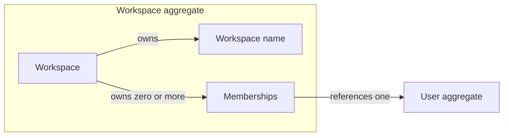

# Workspaces

The Workspaces domain models workspaces and the Users who are their members.
A Workspace groups [Users](users.md#user) under a shared name. Whether
membership grants authority, and which authority is needed to manage
Workspaces, is not yet decided.

## Model structure

| Concept | Classification | Boundary and relationships |
| --- | --- | --- |
| Workspace | Entity and aggregate root | Owns a name and its memberships; references Users only by identity. |
| Membership | Value object | Records that one User belongs to one Workspace; owned by that Workspace. |
| Workspace identity | Value object | Identifies a Workspace independently of its name and members. |
| Workspace name | Value object | Names a Workspace in plain, untranslated text. |

## Workspace aggregate

A Workspace is a named group of Users. Its identity remains the same when its
name or members change. The Workspace aggregate contains its memberships; the
Users they reference have their own lifecycle and are outside the aggregate.

| Field | Domain value | Required | Meaning and rules |
| --- | --- | --- | --- |
| Identity | Workspace identity | Yes | Distinguishes this Workspace from all other Workspaces; nonempty, assigned on creation, and stable. |
| Name | Workspace name | Yes | Names the Workspace; need not be unique among Workspaces. |
| Members | Collection of memberships | Yes; may be empty | Lists the Users who belong to the Workspace, at most once each; unordered. |

Renaming a Workspace changes only its name. Adding or removing a member changes
only its memberships.

Deleting a Workspace removes all of its memberships; the Users who were its
members remain.

### Membership

A Membership records that a User belongs to a Workspace. It has no identity of
its own: the Workspace and User it relates determine it, and two Memberships
relating the same Workspace and User are the same Membership.

| Field | Domain value | Required | Meaning and rules |
| --- | --- | --- | --- |
| Workspace | Workspace identity | Yes | Identifies the Workspace that owns the Membership. |
| User | [User identity](users.md#account-and-authority-values) | Yes | References one existing User by identity; the User is not part of the Workspace aggregate. |

## Value objects

| Value object | Field | Meaning and rules |
| --- | --- | --- |
| Workspace identity | Identity value | Nonempty identity of one Workspace. |
| Workspace name | Name text | Plain text that is not translated. Leading and trailing whitespace is removed from a supplied name; the result is valid text with a non-whitespace character, has no leading or trailing whitespace, and is at most 100 characters. |

## Aggregate invariants

- A Workspace has at most one Membership for any User.
- A Workspace may have no members.
- Every Membership belongs to exactly one Workspace and ends when that
  Workspace is deleted.

## Invariants across aggregates

- Every Membership references an existing User.
- A User may be a member of any number of Workspaces, including none.
- Deleting a User removes that User's Memberships from every Workspace and
  leaves the Workspaces, including any left with no members.
